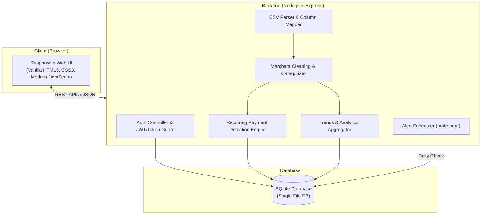
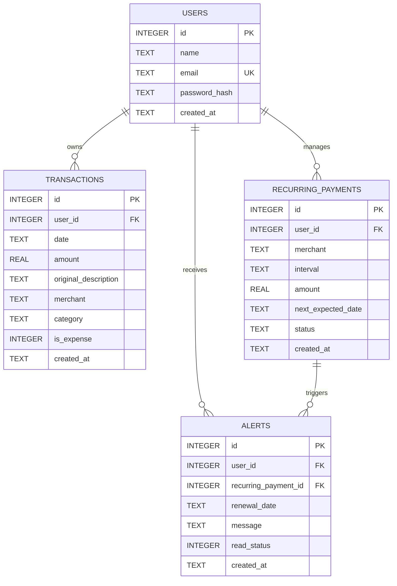

# SpendGuard — Project Context & Specification

> **Source Document:** [SRS_SpendGuard.pdf](file:///c:/Projects/project%20spendgaurd/SRS_SpendGuard.pdf)  
> **Status:** Active / Blueprint  
> **Target Currency:** Indian Rupee (INR - ₹)

---

## 1. Executive Summary & Purpose

**SpendGuard** is a lightweight, privacy-focused personal finance web application designed to help individuals and small teams gain full clarity over their spending patterns. 

By importing transaction history through standard bank CSV exports, SpendGuard automatically cleans cryptic bank merchant descriptions, categorizes expenses, detects recurring payments and subscription commitments, provides visual spending analytics, and generates proactive alerts prior to renewal dates.

---

## 2. Problem Statement & Scope Boundaries

### The Problem
- Modern bank statements often contain noisy, ambiguous descriptions (e.g., `UPI/524312/NETFLIX COM/POS`, `ACH WDL SPOTIFY INDIA 8007`).
- Users accumulate recurring subscriptions across streaming, software, fitness, and utility services, resulting in unwanted auto-renewals and "subscription creep."
- Many existing tools demand direct bank credentials (raising security/privacy concerns) or charge high monthly subscription fees themselves.

### In Scope
- **CSV Ingestion Engine:** Upload bank CSV files, auto-detect or manually map columns (Date, Description, Amount), skip malformed rows, and ignore duplicates.
- **Rule-Based Merchant Cleaning:** Regex and dictionary-driven normalization to extract human-readable merchant names.
- **Automated Categorization:** Rule-based classification into predefined expense buckets (Food, Shopping, Entertainment, Bills, Transport, Health, Subscriptions, Other).
- **Recurring Payment Detection:** Heuristic interval detection (weekly, monthly, quarterly, yearly) with jitter tolerance for billing dates and minor amount variances.
- **Analytics & Visual Trends:** Current month total spend, multi-month expenditure trends, category distributions, and active subscription overhead.
- **Renewal Calendar & Alerts:** Visual upcoming renewal calendar, 30-day lookahead, and automated daily background alert generation.
- **Authentication & Multi-Tenant Data Isolation:** Secure email/password login, password hashing, token validation, and strict per-user data isolation.

### Out of Scope (Explicitly Excluded)
- Live bank API connections / Open Banking aggregators.
- Native PDF statement parsing.
- Multi-currency conversions (all amounts strictly in INR ₹).
- External paid AI/LLM APIs for categorization (all logic is rule-based and local).

---

## 3. Technology Stack & Architecture

### Technology Selections
| Layer | Technology | Rationale / Specification |
| :--- | :--- | :--- |
| **Frontend** | HTML5, Vanilla CSS3, JavaScript (ES6+) | Lightweight, fast-loading, zero build tool overhead, fully responsive for desktop & mobile. |
| **Backend** | Node.js, Express.js | Event-driven I/O, simple REST API routing, broad ecosystem. |
| **Database** | SQLite | Single-file database, zero-configuration setup, local persistence, portable. |
| **Background Jobs** | `node-cron` | Lightweight in-process scheduler for daily renewal checks and alert generation. |
| **Security** | Password Hashing (bcrypt), Token-based Auth | Secure credential storage, stateless or token-verified authenticated sessions, `.env` config. |

---

## 4. User Personas

1. **Individual User (Primary):**
   - Wants to track personal expenditures from one or multiple bank accounts.
   - Needs to identify forgotten subscriptions and be alerted 2–5 days before recurring charges hit.
2. **Team User (Optional / Secondary):**
   - Small team or startup sharing a single company card or account.
   - Tracks shared SaaS tools, hosting, and service renewals to avoid billing surprises.

---

## 5. Functional Requirements & Feature Modules

### Module 1: Authentication & User Isolation
- **User Registration:** Name, unique email, password.
- **User Login:** Email and password verification returning an authentication token.
- **Security:** Passwords securely hashed; secret keys and tokens stored in `.env`.
- **Data Scoping:** Every query and data access must strictly filter by the authenticated `user_id`.
- **Account Management (Optional):** Ability for a user to delete their account and cascade-delete all associated data.

### Module 2: CSV Ingestion Engine
- **File Upload:** Accepts `.csv` exports from various banks.
- **Header Auto-Detection & Column Mapping:** Automatically infers `Date`, `Description`, and `Amount` columns, with user review/override prior to commit.
- **Date Format Support:** Handles formats such as `DD/MM/YYYY`, `MM/DD/YYYY`, `YYYY-MM-DD`, and variations.
- **Debit Filtering:** Only debit/expense transactions are analyzed; deposits/credits are excluded.
- **Fault Tolerance:** Invalid/malformed rows are logged and displayed in an error summary without halting the valid rows.
- **Deduplication:** Prevents duplicate transaction records if the same CSV or overlapping date ranges are re-imported.
- **Optional Enhancements:** Live preview table before final import confirmation; historical upload log.

### Module 3: Merchant Cleaning & Rule-Based Categorization
- **String Cleaning Pipeline:**
  - Strip banking noise: tokens like `UPI`, `POS`, `NEFT`, `IMPS`, `ACH`, `ATM`, card digits, sequence numbers, transaction IDs, and special characters.
  - Normalize casing and trim redundant whitespace.
- **Canonical Merchant Resolution:**
  - Pattern matching to alias variations (e.g., `"NETFLIX COM"`, `"netflix.com"`, `"NETFLIX INDIA 8007"` $\to$ `"Netflix"`).
- **Categorization Engine:**
  - Assigned categories: `Food`, `Shopping`, `Entertainment`, `Bills`, `Transport`, `Health`, `Subscriptions`, `Other`.
  - Pattern dictionaries (e.g., Swiggy/Zomato $\to$ `Food`, Uber/Ola $\to$ `Transport`, Netflix/Spotify $\to$ `Subscriptions`/`Entertainment`).
  - Fallback: Unmatched transactions fallback to `Other` and are flagged for user review.
- **Optional Enhancements:** Allow users to manually modify a transaction's cleaned merchant name or category.

### Module 4: Recurring Payment & Subscription Detection
- **Grouping:** Group historical expense transactions by normalized canonical merchant.
- **Cadence Analysis:** Compute day intervals between successive payments to determine cadence:
  - **Weekly:** ~7 days ($\pm 2$ days)
  - **Monthly:** ~30 days ($\pm 4$ days)
  - **Quarterly:** ~90 days ($\pm 7$ days)
  - **Yearly:** ~365 days ($\pm 10$ days)
- **Amount Variance Tolerance:**
  - Minor variance allowed (e.g., small currency shifts, taxes, or minor rate revisions).
  - Significant divergence flagged as a "price change" rather than a distinct subscription.
- **Metric Computation:**
  - Calculates normalized monthly cost (e.g., yearly cost / 12).
  - Projects `next_expected_date` from the latest payment date + cadence.
- **Execution Hook:** Triggered automatically upon completion of each CSV import batch.
- **Optional Enhancements:** Allow users to manually verify, delete, adjust, or manually create recurring payments.

### Module 5: Dashboard, Analytics & Spending Trends
- **Key Metrics Cards:**
  - Total expenditure for the current calendar month (in ₹).
  - Total active subscriptions count and cumulative monthly recurring commitment (in ₹).
- **Charts & Visualizations:**
  - Spending trends over time (multi-month historical bar or line chart).
  - Category-wise spending breakdown (doughnut or pie chart).
- **Searchable Transactions View:** Complete tabular transaction log with date range filters, category filter, merchant search, and pagination/scrolling.
- **Optional Enhancements:**
  - Category spending spike alerts (warning when category expenditure significantly exceeds historical monthly averages).
  - Anomaly/unusual payment highlight (e.g., when a subscription amount unexpectedly rises).

### Module 6: Renewal Calendar & Alerting System
- **Renewal Calendar:** Visual calendar interface highlighting projected subscription renewal dates.
- **Upcoming List:** Chronological 30-day forecast table/list displaying merchant, renewal date, and expected amount.
- **Daily Cron Alert Job (`node-cron`):**
  - Runs once daily at midnight server time.
  - Scans active recurring payments where `next_expected_date - current_date <= lead_days` (default: 3 days).
  - Generates an in-app `Alert` record.
- **Alert Deduplication:** Guarantees that duplicate alerts are not generated for the same recurring payment cycle.
- **Optional Enhancements:** Configurable lead-time settings (e.g., alert 1, 3, or 7 days ahead); outbound email notifications.

---

## 6. Page Map & User Interface Requirements

| Page | URL Route | Core Responsibilities |
| :--- | :--- | :--- |
| **Register** | `/register` | User signup form (name, email, password) with client-side validation. |
| **Login** | `/login` | Authentication form, credential submission, session/token acquisition. |
| **Dashboard** | `/dashboard` or `/` | High-level financial pulse: current month total, subscription total, multi-month trend chart, category breakdown chart, quick alert feed. |
| **Import** | `/import` | Drag-and-drop CSV upload, column auto-detector and selector, preview, import progress, error report. |
| **Transactions** | `/transactions` | Detailed transaction list with keyword search, category filter, date filtering, and editable merchant/category tags (if enabled). |
| **Subscriptions** | `/subscriptions` | List of detected recurring payments, interval cadence, monthly equivalent, next charge date, and status toggle (active/paused). |
| **Calendar** | `/calendar` | Interactive monthly calendar displaying scheduled renewals on their due dates. |
| **Alerts** | `/alerts` | Notification inbox listing unread and read renewal reminders and spending notifications. |

*Design Requirement:* Responsive layout adapting seamlessly to mobile, tablet, and desktop viewports.

---

## 7. Database Schema & Data Models

SpendGuard utilizes an SQLite database storing all persistent state in a single file.

### Table Definitions

#### `users`
- `id` (INTEGER, PRIMARY KEY AUTOINCREMENT)
- `name` (TEXT, NOT NULL)
- `email` (TEXT, NOT NULL, UNIQUE)
- `password_hash` (TEXT, NOT NULL)
- `created_at` (DATETIME, DEFAULT CURRENT_TIMESTAMP)

#### `transactions`
- `id` (INTEGER, PRIMARY KEY AUTOINCREMENT)
- `user_id` (INTEGER, NOT NULL, FOREIGN KEY $\to$ `users(id)`)
- `date` (TEXT / DATE, NOT NULL — format: `YYYY-MM-DD`)
- `amount` (REAL, NOT NULL — positive numeric value in INR)
- `original_description` (TEXT, NOT NULL)
- `merchant` (TEXT, NOT NULL — cleaned canonical name)
- `category` (TEXT, NOT NULL — Food, Shopping, Entertainment, etc.)
- `is_expense` (INTEGER, DEFAULT 1 — boolean: 1 for debit, 0 for credit)
- `created_at` (DATETIME, DEFAULT CURRENT_TIMESTAMP)

#### `recurring_payments`
- `id` (INTEGER, PRIMARY KEY AUTOINCREMENT)
- `user_id` (INTEGER, NOT NULL, FOREIGN KEY $\to$ `users(id)`)
- `merchant` (TEXT, NOT NULL)
- `interval` (TEXT, NOT NULL — `weekly`, `monthly`, `quarterly`, `yearly`)
- `amount` (REAL, NOT NULL — expected charge amount)
- `next_expected_date` (TEXT / DATE, NOT NULL — format: `YYYY-MM-DD`)
- `status` (TEXT, DEFAULT 'active' — `active`, `paused`, `cancelled`)
- `created_at` (DATETIME, DEFAULT CURRENT_TIMESTAMP)

#### `alerts`
- `id` (INTEGER, PRIMARY KEY AUTOINCREMENT)
- `user_id` (INTEGER, NOT NULL, FOREIGN KEY $\to$ `users(id)`)
- `recurring_payment_id` (INTEGER, FOREIGN KEY $\to$ `recurring_payments(id)`)
- `renewal_date` (TEXT / DATE, NOT NULL)
- `message` (TEXT, NOT NULL)
- `read_status` (INTEGER, DEFAULT 0 — boolean: 0 for unread, 1 for read)
- `created_at` (DATETIME, DEFAULT CURRENT_TIMESTAMP)

---

## 8. Non-Functional Requirements & Constraints

| Category | Requirement |
| :--- | :--- |
| **Performance** | Dashboard and primary views must render in $\le 3$ seconds under standard local workloads. Standard bank CSV files ($\le 10,000$ rows) should parse and ingest rapidly. |
| **Security** | Passwords salted and hashed with modern hashing algorithms (e.g., bcrypt). Authentication verified via secure tokens. Strict tenant isolation on every SQL query. Secret keys kept exclusively in `.env`. |
| **Reliability** | Parsing errors on individual CSV rows must not abort the overall import batch. Daily cron jobs must be idempotent and verify existing alerts before inserting. |
| **Usability & UX** | Minimalist, intuitive navigation, responsive mobile styling, explicit form validations, and human-friendly error messages. |
| **Localization** | Financial amounts expressed in INR (₹). Standard Indian bank CSV quirks (e.g. UPI handles, POS transaction notations) handled gracefully. |

---

## 9. Future Scope & Roadmap
- AI-driven categorization for ambiguous or rare merchant descriptions.
- Direct Open Banking API integration (Account Aggregator framework) for automated syncing.
- Multi-channel notification delivery (Email via SMTP, Push Notifications).
- Category budget allocation with overspending thresholds and warning badges.
- Native parser for password-protected PDF bank statements.
