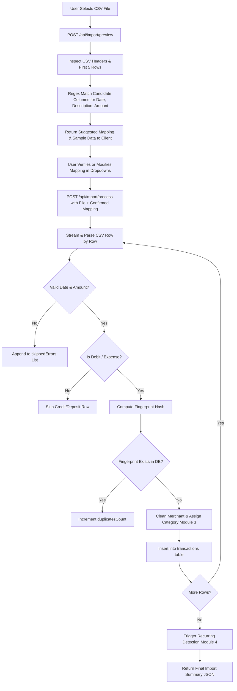

# Implementation Plan: Module 2 — CSV Import & Ingestion Engine

> **Module:** 02 — CSV Import  
> **Source Documents:** [SRS_SpendGuard.pdf](file:///c:/Projects/project%20spendgaurd/SRS_SpendGuard.pdf), [content.md](file:///c:/Projects/project%20spendgaurd/content.md)  
> **Target Path:** `docs/plans/02_csv_import.md`

---

## 1. Overview & Objectives
The CSV Ingestion Engine allows users to upload standard bank transaction export files (.csv), auto-detects or permits manual mapping of key columns (`Date`, `Description`, `Amount`), parses flexible date/number formats, filters debit expenses (excluding income/credit), gracefully skips malformed rows with user-visible errors, and skips duplicate transactions on re-upload.

Successful import immediately invokes the Cleaning & Categorization pipeline (Module 3) and Recurring Payment Detection (Module 4).

---

## 2. Requirements & Scope

### Core Requirements
- **File Upload:** Accept standard `.csv` files up to 10 MB via `multipart/form-data`.
- **Column Detection & Mapping:**
  - Auto-detect column headers using regex heuristics (e.g. `Date`: `/(date|txn_date|transaction_date|value_date)/i`, `Description`: `/(description|narration|particulars|details|merchant|remarks)/i`, `Amount`: `/(amount|debit|withdrawal|spent|inr)/i`).
  - Allow the user to review and correct detected column mappings in the UI before committing.
- **Date Normalization:** Robust parsing supporting `DD/MM/YYYY`, `MM/DD/YYYY`, `YYYY-MM-DD`, `DD-MM-YYYY`, `DD MMM YYYY`, etc., normalized to standard ISO format (`YYYY-MM-DD`).
- **Amount & Debit Filtering:**
  - Standardize numeric amounts (strip commas, `₹`, `INR`, currency symbols).
  - Debit filtering: If the CSV has separate Debit/Credit columns, only ingest rows with Debit values; if it has a Type column (`DR`/`CR`), only accept `DR`; if signed amounts are used, negative amounts or positive amounts mapped as expenses are imported.
- **Row-Level Error Handling & Fault Tolerance:**
  - Malformed rows (unparseable dates, non-numeric amounts, missing mandatory fields) are skipped rather than aborting the import.
  - Return an error list containing row numbers and specific reasons for skipping.
- **Deduplication:**
  - Generate a composite fingerprint hash: `SHA256(user_id + date + normalized_amount + original_description)`.
  - Check against existing database records; skip duplicates without throwing fatal errors.
  - Report: Total rows read, imported count, duplicate count, skipped/error count.

### Optional Features
- **Import Preview Table:** Show first 5-10 rows with mapped fields before finalizing import.
- **Import History Log:** Record past upload metadata (filename, upload date, imported count, failed count).

---

## 3. Database Schema

```sql
CREATE TABLE IF NOT EXISTS transactions (
    id INTEGER PRIMARY KEY AUTOINCREMENT,
    user_id INTEGER NOT NULL,
    date TEXT NOT NULL,                         -- Standard ISO format: YYYY-MM-DD
    amount REAL NOT NULL,                       -- Positive decimal in INR
    original_description TEXT NOT NULL,         -- Raw bank narration
    merchant TEXT NOT NULL,                     -- Cleaned canonical merchant name (Module 3)
    category TEXT NOT NULL DEFAULT 'Other',     -- Categorized bucket (Module 3)
    is_expense INTEGER DEFAULT 1,               -- 1 = Debit/Expense, 0 = Credit
    fingerprint TEXT NOT NULL,                  -- SHA-256 deduplication key
    created_at DATETIME DEFAULT CURRENT_TIMESTAMP,
    FOREIGN KEY (user_id) REFERENCES users(id) ON DELETE CASCADE
);

CREATE UNIQUE INDEX IF NOT EXISTS idx_txn_user_fingerprint ON transactions(user_id, fingerprint);
CREATE INDEX IF NOT EXISTS idx_txn_user_date ON transactions(user_id, date);
CREATE INDEX IF NOT EXISTS idx_txn_user_category ON transactions(user_id, category);

-- Optional: Import History Table
CREATE TABLE IF NOT EXISTS import_batches (
    id INTEGER PRIMARY KEY AUTOINCREMENT,
    user_id INTEGER NOT NULL,
    filename TEXT NOT NULL,
    total_rows INTEGER DEFAULT 0,
    imported_count INTEGER DEFAULT 0,
    duplicate_count INTEGER DEFAULT 0,
    error_count INTEGER DEFAULT 0,
    created_at DATETIME DEFAULT CURRENT_TIMESTAMP,
    FOREIGN KEY (user_id) REFERENCES users(id) ON DELETE CASCADE
);
```

---

## 4. API Endpoints Specification

| Method | Endpoint | Auth | Description | Payload | Response (Success) |
| :--- | :--- | :--- | :--- | :--- | :--- |
| `POST` | `/api/import/preview` | Bearer | Upload CSV and return detected headers + preview rows | `multipart/form-data` (`file`) | `200 OK`: `{ "headers": [...], "suggestedMapping": { "date": "Date", "description": "Narration", "amount": "Debit" }, "previewRows": [...] }` |
| `POST` | `/api/import/process` | Bearer | Commit parsed CSV with user-approved mappings | `multipart/form-data` (`file`, `columnMapping` JSON, `dateFormat` optional) | `200 OK`: `{ "batchId": 12, "summary": { "total": 120, "imported": 110, "duplicates": 8, "errors": 2 }, "errorRows": [{ "row": 15, "reason": "Invalid date: 31/02/2026" }] }` |
| `GET` | `/api/import/history` | Bearer | Get user's import history logs (Optional) | Query params: `limit=10` | `200 OK`: `{ "batches": [...] }` |

---

## 5. CSV Parsing & Column Detection Algorithm



---

## 6. Implementation Steps

1. **Multer & CSV Parser Setup:**
   - Configure memory storage or temporary upload stream via `multer`.
   - Use `csv-parser` or `fast-csv` for efficient, memory-safe streaming.
2. **Column Heuristic Detector:**
   - Create `backend/services/csvParser.service.js` with header matcher patterns.
   - Support standard Indian bank statement formats (HDFC, SBI, ICICI, Axis, Kotak, etc.).
3. **Date & Currency Parser Utility:**
   - Write resilient parser supporting multiple formats without crashing on empty or corrupt date strings.
   - Clean amount strings (remove currency symbols, commas, trailing `CR`/`DR`).
4. **Deduplication Engine:**
   - Generate SHA-256 hash using crypto: `crypto.createHash('sha256').update(rawStr).digest('hex')`.
   - Batch insert valid transactions into SQLite using a transaction block.
5. **Frontend UI Components (`import.html` / `import.js`):**
   - Modern drag-and-drop file upload zone.
   - Dynamic mapping modal/panel displaying detected column selections with fallback `<select>` dropdowns.
   - Live sample preview table showing how mapped columns will resolve.
   - Processing status indicator followed by a comprehensive Import Summary modal (Rows processed, imported, skipped, error list).

---

## 7. Test Cases & Verification Checklist

- [ ] **TC-01:** Uploading a standard HDFC/SBI/ICICI CSV correctly auto-detects `Date`, `Description`, and `Amount` headers.
- [ ] **TC-02:** User can manually re-map columns if auto-detection picks the wrong column.
- [ ] **TC-03:** Dates in `DD/MM/YYYY`, `MM/DD/YYYY`, and `YYYY-MM-DD` convert to uniform `YYYY-MM-DD`.
- [ ] **TC-04:** Rows with malformed amounts (e.g. alphanumeric strings) are skipped and reported in `errorRows`.
- [ ] **TC-05:** Credit/deposit transactions are safely filtered out and not counted as expenses.
- [ ] **TC-06:** Re-uploading the exact same CSV results in 0 newly inserted rows and reports all rows as duplicates.
- [ ] **TC-07:** Large CSV files (5,000+ rows) parse and insert within under 3 seconds.
- [ ] **TC-08:** Successful import triggers recurring payment detection in the background.
