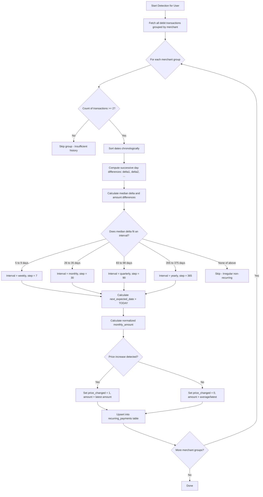

# Implementation Plan: Module 4 — Recurring Payment Detection

> **Module:** 04 — Recurring Payment Detection  
> **Source Documents:** [SRS_SpendGuard.pdf](file:///c:/Projects/project%20spendgaurd/SRS_SpendGuard.pdf), [content.md](file:///c:/Projects/project%20spendgaurd/content.md)  
> **Target Path:** `docs/plans/04_recurring_payment_detection.md`

---

## 1. Overview & Objectives
Recurring payment detection analyzes the user's historical expense transactions to automatically identify subscriptions and recurring commitments (e.g., Netflix, Spotify, gym memberships, utility bills, cloud hosting). 

The algorithm groups transactions by canonical merchant, analyzes day gaps between successive transactions to detect intervals (weekly, monthly, quarterly, yearly), accounts for weekend/holiday date drift, tolerates small amount fluctuations, detects price hikes, projects the next expected renewal date, calculates normalized monthly cost, and triggers automatically after every CSV import.

---

## 2. Requirements & Scope

### Core Requirements
- **Grouping & Sorting:**
  - Group transactions by `merchant` for the authenticated `user_id`.
  - Sort transactions in each merchant group chronologically by `date` ascending.
  - Require at least 2 transactions (ideally 3+ transactions across $\ge 60-90$ days) to confirm a recurring pattern.
- **Interval Detection with Jitter Tolerance:**
  - Calculate day differences between successive transactions: $\Delta d_i = d_{i+1} - d_i$.
  - Match median / average delta to interval categories with tolerance windows:
    - **Weekly:** Median $\approx 7$ days ($\pm 2$ days; 5–9 days)
    - **Monthly:** Median $\approx 30$ days ($\pm 4$ days; 26–35 days)
    - **Quarterly:** Median $\approx 90$ days ($\pm 7$ days; 83–98 days)
    - **Yearly:** Median $\approx 365$ days ($\pm 10$ days; 355–375 days)
- **Amount Consistency & Price Change Detection:**
  - Calculate variance of amounts within the group:
    - If $|Amount_i - Amount_{i-1}| \le 5\%$ (or $\le ₹50$): considered minor variance (taxes/forex), accepted as stable amount.
    - If a permanent price increase is detected (e.g. ₹649 $\to$ ₹799), use the most recent amount as the active subscription amount and flag `price_changed = 1`.
- **Metrics Calculation:**
  - **Normalized Monthly Cost (`monthly_amount`):**
    - Weekly: $Amount \times 4.333$
    - Monthly: $Amount$
    - Quarterly: $Amount / 3$
    - Yearly: $Amount / 12$
  - **Next Expected Renewal Date (`next_expected_date`):**
    - From the most recent transaction date $D_{latest}$, project forward by the interval until the date is in the future relative to today's date.
- **Trigger Lifecycle:**
  - Trigger detection automatically whenever a new CSV batch is committed in Module 2.
  - Upsert into `recurring_payments` table (preserve existing user modifications if already confirmed).

### Optional Features
- **User Actions:** User can manually confirm, pause, delete, or manually create a recurring payment.
- **Price Spike Flag:** Visual badge showing recent price hike percentage on subscription cards.

---

## 3. Database Schema

```sql
CREATE TABLE IF NOT EXISTS recurring_payments (
    id INTEGER PRIMARY KEY AUTOINCREMENT,
    user_id INTEGER NOT NULL,
    merchant TEXT NOT NULL,
    interval TEXT NOT NULL,                     -- 'weekly', 'monthly', 'quarterly', 'yearly'
    amount REAL NOT NULL,                       -- Current expected amount in INR
    monthly_amount REAL NOT NULL,               -- Calculated monthly equivalent cost
    next_expected_date TEXT NOT NULL,           -- Format: YYYY-MM-DD
    status TEXT NOT NULL DEFAULT 'active',      -- 'active', 'paused', 'cancelled'
    price_changed INTEGER DEFAULT 0,            -- 1 if recent price change detected
    last_payment_date TEXT NOT NULL,            -- Date of the latest known transaction
    is_user_created INTEGER DEFAULT 0,          -- 1 if manually added by user
    created_at DATETIME DEFAULT CURRENT_TIMESTAMP,
    updated_at DATETIME DEFAULT CURRENT_TIMESTAMP,
    FOREIGN KEY (user_id) REFERENCES users(id) ON DELETE CASCADE
);

CREATE UNIQUE INDEX IF NOT EXISTS idx_recurring_user_merchant ON recurring_payments(user_id, merchant);
CREATE INDEX IF NOT EXISTS idx_recurring_next_date ON recurring_payments(user_id, next_expected_date);
```

---

## 4. Detection Algorithm Specification



---

## 5. API Endpoints Specification

| Method | Endpoint | Auth | Description | Payload | Response (Success) |
| :--- | :--- | :--- | :--- | :--- | :--- |
| `POST` | `/api/recurring/detect` | Bearer | Manually trigger detection run | None | `200 OK`: `{ "detectedCount": 5, "subscriptions": [...] }` |
| `GET` | `/api/recurring` | Bearer | List all recurring subscriptions | Query: `status=active` | `200 OK`: `{ "subscriptions": [...], "totalMonthlyCost": 2450.00, "count": 6 }` |
| `POST` | `/api/recurring` | Bearer | Manually create a recurring subscription (Optional) | `{ "merchant": "Gym", "interval": "monthly", "amount": 1500, "nextExpectedDate": "2026-11-01" }` | `201 Created`: `{ "subscription": { ... } }` |
| `PATCH` | `/api/recurring/:id` | Bearer | Update status, amount, or date (Optional) | `{ "status": "paused" }` | `200 OK`: `{ "subscription": { ... } }` |
| `DELETE` | `/api/recurring/:id` | Bearer | Remove recurring payment (Optional) | None | `200 OK`: `{ "message": "Subscription removed" }` |

---

## 6. Implementation Steps

1. **Detection Engine Service (`backend/services/recurringDetector.service.js`):**
   - Query all transactions for user grouped by `merchant`:
     ```sql
     SELECT id, merchant, date, amount FROM transactions 
     WHERE user_id = ? AND is_expense = 1 
     ORDER BY merchant, date ASC;
     ```
   - Partition into memory groups by `merchant`.
   - Calculate delta intervals between consecutive records.
   - Match to cadence buckets (weekly, monthly, quarterly, yearly).
   - Project `next_expected_date` past the current system date.
   - Detect significant amount spikes between the penultimate and final transactions ($> 10\%$ increase) and mark `price_changed = 1`.
2. **Database Upsert Logic:**
   - Use SQLite `INSERT ... ON CONFLICT(user_id, merchant) DO UPDATE SET ...` to update latest amount, interval, and next expected date while preserving user custom statuses.
3. **Frontend Subscriptions UI (`subscriptions.html` / `subscriptions.js`):**
   - Summary bar: Active subscriptions count, total monthly commitment (₹), upcoming renewals this month.
   - Cards/Table view: Merchant name, interval badge (`Monthly`, `Yearly`), expected charge, monthly cost equivalent, next expected date, price hike tag.
   - Action buttons: Pause, resume, remove, or edit.

---

## 7. Test Cases & Verification Checklist

- [ ] **TC-01:** Transactions on 2026-06-05, 2026-07-05, 2026-08-05 for `Netflix` at ₹649 detect as `monthly` with `next_expected_date` in the future.
- [ ] **TC-02:** Billing date shifts due to weekends (e.g. 28 days or 32 days apart) are successfully matched to `monthly`.
- [ ] **TC-03:** Weekly transactions (e.g. every Sunday $\pm 1$ day) are identified as `weekly`.
- [ ] **TC-04:** An increase from ₹499 to ₹649 marks `price_changed = 1` and uses ₹649 as the active subscription amount.
- [ ] **TC-05:** Single one-off transactions (e.g., flight ticket, furniture) are correctly ignored.
- [ ] **TC-06:** Re-running detection updates `next_expected_date` without duplicating rows in `recurring_payments`.
- [ ] **TC-07:** Normalized `monthly_amount` correctly calculates $Amount / 12$ for yearly and $Amount \times 4.333$ for weekly.
