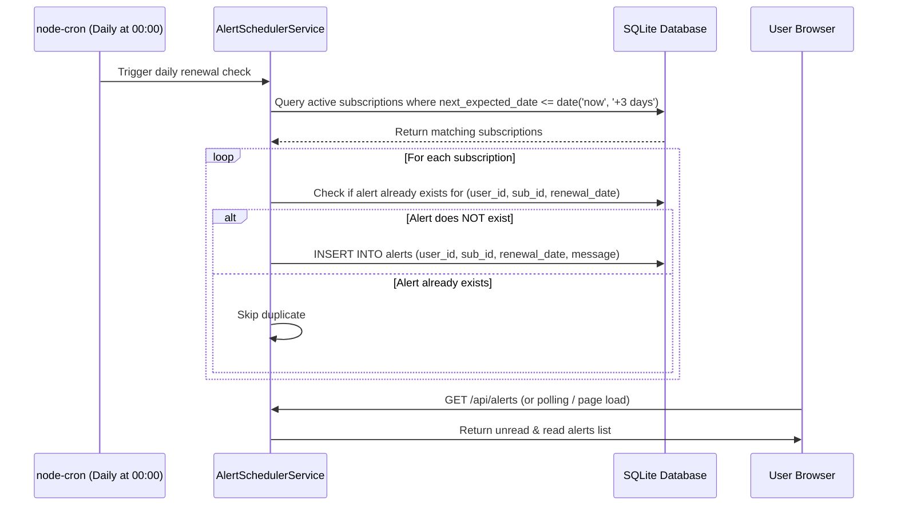

# Implementation Plan: Module 6 — Renewal Calendar & Alerting System

> **Module:** 06 — Renewal Calendar and Alerts  
> **Source Documents:** [SRS_SpendGuard.pdf](file:///c:/Projects/project%20spendgaurd/SRS_SpendGuard.pdf), [content.md](file:///c:/Projects/project%20spendgaurd/content.md)  
> **Target Path:** `docs/plans/06_renewal_calendar_and_alerts.md`

---

## 1. Overview & Objectives
The Renewal Calendar & Alerting System ensures users are never surprised by recurring charges. 

It provides an interactive visual calendar displaying upcoming renewals, a dedicated 30-day forecast list, an in-app notification center, and an automated background scheduler (`node-cron`) that evaluates upcoming payment dates daily and creates deduplicated in-app alerts a few days ahead of renewals.

---

## 2. Requirements & Scope

### Core Requirements
- **Renewal Calendar:**
  - Interactive monthly grid view displaying recurring payment renewals on their scheduled dates.
  - Clicking on a calendar day or event reveals subscription details (merchant, expected amount in ₹, interval).
- **30-Day Upcoming Renewals List:**
  - Chronological forecast view of all subscriptions due in the next 30 calendar days (`today <= next_expected_date <= today + 30 days`).
  - Displays relative countdown badges (e.g., "Due in 2 days", "Tomorrow", "In 18 days").
- **Daily Alert Scheduler (`node-cron`):**
  - Runs a daily cron job (e.g., `0 0 * * *` at midnight) on the Node.js server.
  - Finds all active subscriptions where `next_expected_date` is approaching within $N$ days (default: 3 days).
  - Generates an in-app alert with a human-friendly message: `"Upcoming renewal: Netflix (₹649) is due on 2026-10-07"`.
- **Alert Deduplication & Idempotency:**
  - Unique composite index or check preventing duplicate alerts: `(user_id, recurring_payment_id, renewal_date)`.
  - Ensures re-running the cron job never generates duplicate alerts for the same billing cycle.
- **In-App Notification Center:**
  - Header bell icon with unread count badge.
  - Dedicated Alerts page (`/alerts`) or drawer.
  - Mark single alert as read, or mark all as read.

### Optional Features
- **Custom Alert Lead Time:**
  - Allow users to configure how many days in advance they wish to receive alerts (e.g., 1, 3, 5, or 7 days).
- **Outbound Email Notifications:**
  - Dispatch transactional email alerts via `nodemailer` (SMTP or local test mailer).

---

## 3. Database Schema

```sql
CREATE TABLE IF NOT EXISTS alerts (
    id INTEGER PRIMARY KEY AUTOINCREMENT,
    user_id INTEGER NOT NULL,
    recurring_payment_id INTEGER NOT NULL,
    renewal_date TEXT NOT NULL,                  -- Format: YYYY-MM-DD
    message TEXT NOT NULL,                       -- Human readable alert text
    read_status INTEGER DEFAULT 0,               -- 0 = unread, 1 = read
    created_at DATETIME DEFAULT CURRENT_TIMESTAMP,
    FOREIGN KEY (user_id) REFERENCES users(id) ON DELETE CASCADE,
    FOREIGN KEY (recurring_payment_id) REFERENCES recurring_payments(id) ON DELETE CASCADE
);

CREATE UNIQUE INDEX IF NOT EXISTS idx_alert_unique_cycle 
ON alerts(user_id, recurring_payment_id, renewal_date);

CREATE INDEX IF NOT EXISTS idx_alerts_user_status ON alerts(user_id, read_status);

-- Optional: User Alert Settings Table
CREATE TABLE IF NOT EXISTS user_settings (
    user_id INTEGER PRIMARY KEY,
    alert_lead_days INTEGER DEFAULT 3,
    email_alerts_enabled INTEGER DEFAULT 0,
    created_at DATETIME DEFAULT CURRENT_TIMESTAMP,
    FOREIGN KEY (user_id) REFERENCES users(id) ON DELETE CASCADE
);
```

---

## 4. Scheduled Job Architecture & Flow



---

## 5. API Endpoints Specification

| Method | Endpoint | Auth | Description | Payload / Query | Response (Success) |
| :--- | :--- | :--- | :--- | :--- | :--- |
| `GET` | `/api/calendar/renewals` | Bearer | Fetch renewals for calendar view | `month=YYYY-MM` | `200 OK`: `{ "renewals": [{ "id": 1, "merchant": "Netflix", "amount": 649, "date": "2026-10-07", "interval": "monthly" }] }` |
| `GET` | `/api/renewals/upcoming` | Bearer | Fetch next 30 days renewals list | `days=30` | `200 OK`: `{ "upcoming": [{ "id": 1, "merchant": "Netflix", "amount": 649, "date": "2026-10-07", "daysLeft": 3 }] }` |
| `GET` | `/api/alerts` | Bearer | Fetch user's in-app alerts | `unreadOnly=false` | `200 OK`: `{ "alerts": [...], "unreadCount": 2 }` |
| `PATCH` | `/api/alerts/:id/read` | Bearer | Mark specific alert as read | None | `200 OK`: `{ "alert": { "id": 1, "read_status": 1 } }` |
| `PATCH` | `/api/alerts/mark-all-read` | Bearer | Mark all user alerts as read | None | `200 OK`: `{ "message": "All alerts marked as read" }` |
| `POST` | `/api/alerts/cron-trigger` | Bearer | Manual trigger for dev & automated testing | None | `200 OK`: `{ "alertsCreated": 3 }` |

---

## 6. Implementation Steps

1. **Alert Scheduler Service (`backend/services/alertScheduler.service.js`):**
   - Initialize `node-cron`:
     ```javascript
     cron.schedule('0 0 * * *', async () => {
       await runDailyAlertCheck();
     });
     ```
   - Build `runDailyAlertCheck()`:
     - Query all active recurring payments where `next_expected_date BETWEEN date('now') AND date('now', '+3 days')`.
     - Insert alert using `INSERT OR IGNORE` targeting unique constraint `idx_alert_unique_cycle`.
     - If optional email alerts are enabled, invoke email dispatcher.
2. **Calendar & Upcoming Renewals Service (`backend/services/calendar.service.js`):**
   - Given a month or date range, return all occurrences of active subscriptions falling within that month.
   - For recurring subscriptions with past `next_expected_date`, advance them according to their interval cadence to map future months accurately.
3. **Frontend Calendar View (`calendar.html` / `calendar.js`):**
   - Lightweight, responsive CSS grid calendar (or Vanilla JS calendar component).
   - Monthly navigation buttons (`< Previous Month`, `Next Month >`).
   - Subscription badges rendered on renewal days with hover tooltip / click modal.
4. **Upcoming Renewals List & Notification Center:**
   - 30-day forecast list with countdown chips ("Today", "Tomorrow", "In 3 days").
   - Notification bell in main header with unread badge counter.
   - Alerts dropdown/page with "Mark all as read" button and read status indicators.

---

## 7. Test Cases & Verification Checklist

- [ ] **TC-01:** Subscriptions due in 3 days generate an alert when the cron task executes.
- [ ] **TC-02:** Re-running the cron job multiple times on the same day never generates duplicate alerts.
- [ ] **TC-03:** Calendar grid accurately displays recurring subscriptions on their expected renewal dates.
- [ ] **TC-04:** Upcoming 30-day list displays renewals sorted chronologically ascending.
- [ ] **TC-05:** Marking an alert as read updates `read_status` to 1 and decrements the unread badge count.
- [ ] **TC-06:** "Mark all as read" updates all unread alerts for the authenticated user only.
- [ ] **TC-07:** Manual test trigger endpoint `POST /api/alerts/cron-trigger` allows instant verification without waiting for midnight.
